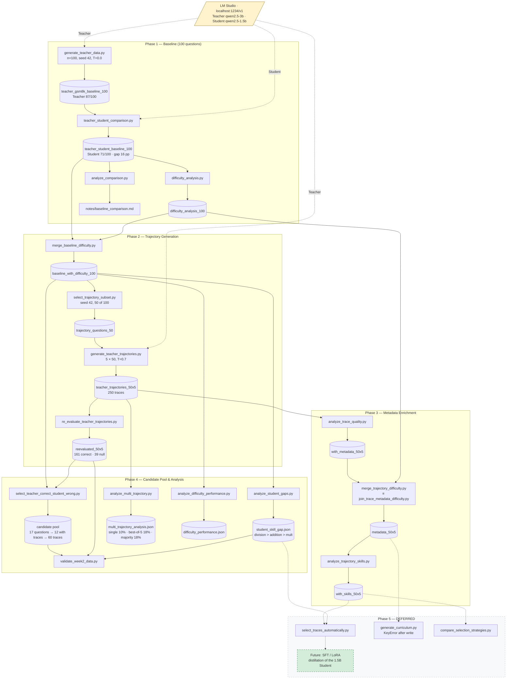

# DACNTT – SLM Reasoning: Project Structure & Pipeline

> Branch: `v1.2-week2-experiments` (Week 2, September 2026)

Research repository for the KLTN/DACNTT project on **reasoning knowledge distillation between two
Small Language Models**. A **Teacher** (Qwen2.5-3B-Instruct) solves GSM8K problems and emits
multiple chain-of-thought trajectories; a **Student** (Qwen2.5-1.5B-Instruct) is benchmarked
against it to locate the questions and skills where the Student fails and the Teacher succeeds.
Those cases become the candidate pool for a future trace-selection + distillation experiment.

Both models are served locally through **LM Studio**'s OpenAI-compatible API at
`http://localhost:1234/v1`. A few scripts also load models directly with Hugging Face
Transformers to verify VRAM fit.

**Current stage:** experimental foundation + candidate trace pool complete.
Trace selection, curriculum, and Student training are **deliberately deferred** until the
method and evaluation protocol are finalized (see `experiments/week2September/README.md` §14–16).

---

## 1. Directory Layout

```text
DACNTT-SLM-Reasoning/
├── README.md                       # Project blurb (STALE: still shows the Week 1 0.5B numbers)
├── PROJECT_STRUCTURE.md            # This document
├── requirements.txt                # Base pip freeze (UTF-16, CRLF)
├── requirements-lock.txt           # Full freeze incl. openai/pydantic (UTF-16, CRLF)
├── .gitignore                      # Ignores venv, weights, datasets, large outputs
│
├── scripts/                        # All executable code (flat scripts, not a package)
│   │  ── Week 1: setup & baseline ──
│   ├── common_lmstudio.py              # Shared LM Studio client + answer parsing
│   ├── check_lmstudio.py               # Server reachability check
│   ├── test_student.py                 # Student via HF Transformers (GPU check)
│   ├── test_teacher.py                 # Teacher via HF Transformers (VRAM check)
│   ├── test_teacher_lmstudio.py        # Teacher via LM Studio API (latency check)
│   ├── inspect_gsm8k.py                # Dataset download + schema validation
│   ├── teacher_smoke_test.py           # Teacher on 5 hand-written problems
│   ├── generate_teacher_data.py        # Teacher baseline over 100 GSM8K items
│   ├── teacher_student_comparison.py   # Student over the same 100 items
│   ├── analyze_comparison.py           # Accuracy + error report → notes/
│   ├── difficulty_analysis.py          # Heuristic difficulty scoring
│   ├── rationale_selection.py          # Week 1 candidate picker (superseded)
│   │
│   │  ── Week 2: trajectories, metadata, selection ──
│   ├── merge_baseline_difficulty.py        # baseline + difficulty → one file
│   ├── select_trajectory_subset.py         # pick 50 of the 100 questions
│   ├── generate_teacher_trajectories.py    # 5 trajectories × 50 questions @ T=0.7
│   ├── re_evaluate_teacher_trajectories.py # re-parse answers, recompute correctness
│   ├── analyze_multi_trajectory.py         # single-shot vs best-of-5 vs majority vote
│   ├── analyze_trace_quality.py            # structural metadata per trace
│   ├── merge_trajectory_difficulty.py      # attach difficulty to traces
│   ├── join_trace_metadata_difficulty.py   # (duplicate of the above, same output)
│   ├── analyze_trajectory_skills.py        # keyword skill tagging per trace
│   ├── select_teacher_correct_student_wrong.py # build the 60-trace candidate pool
│   ├── join_candidate_trace_metadata.py    # (older path into the same output file)
│   ├── analyze_student_gaps.py             # Student skill-gap profile
│   ├── analyze_difficulty_performance.py   # accuracy split by difficulty bucket
│   ├── generate_curriculum.py              # easy→hard ordering (DEFERRED, has a bug)
│   ├── select_traces_automatically.py      # skill-gap-weighted ranking (DEFERRED)
│   ├── compare_selection_strategies.py     # random / difficulty baselines (DEFERRED)
│   └── validate_week2_data.py              # integrity gate over all Week 2 data
│
├── experiments/
│   ├── week2September/             # Canonical Week 2 experiment tree
│   │   ├── README.md                   # 718-line Week 2 lab report (authoritative)
│   │   ├── raw/                        # Unprocessed model outputs
│   │   ├── processed/                  # Merged / enriched / selected data
│   │   ├── results/                    # Aggregate analysis artifacts
│   │   └── logs/                       # Environment + LM Studio evidence
│   └── week2September_backup_2026-09-16/   # Frozen copy — DO NOT OVERWRITE
│
├── outputs/                        # Working JSONL results (Week 1 layout, still live)
├── notes/                          # Research notes; baseline_comparison.md is generated
├── datasets/  models/  papers/     # Placeholders (contents git-ignored or empty)
```

---

## 2. File Reference

### 2.1 Shared Library

| File | Use |
|---|---|
| `scripts/common_lmstudio.py` | Shared helpers: `LM_STUDIO_BASE_URL`, `TEACHER_MODEL = qwen2.5-3b-instruct`, **`STUDENT_MODEL = qwen2.5-1.5b-instruct`** (upgraded from 0.5B this branch), a `requests`-based `chat()` wrapper, `extract_final_answer()` (`#### n` → `\boxed{n}` → `Final Answer: n` → last number), `normalize_answer()` and `answers_equal()`. |

### 2.2 Stage 0 — Environment Verification

| File | Use |
|---|---|
| `scripts/check_lmstudio.py` | Lists loaded LM Studio models and sends one trivial prompt. Exits non-zero if the server is down. Run first when anything fails. |
| `scripts/test_student.py` | Loads **Qwen2.5-1.5B-Instruct** via HF Transformers, runs one hand-written problem greedily, prints GPU memory. |
| `scripts/test_teacher.py` | Same for **Qwen2.5-3B-Instruct** in fp16 — confirms the Teacher fits in the 8 GB RTX 4060 (~5.8 GB observed). |
| `scripts/test_teacher_lmstudio.py` | Same problem through the API instead, printing latency and token usage. Compares the API path against local Transformers. |
| `scripts/inspect_gsm8k.py` | Downloads `openai/gsm8k` (config `main`), asserts the `train`/`test` splits and `question`/`answer` columns exist, prints examples. Hard-fails on schema mismatch. |

### 2.3 Stage 1 — Baseline (100 GSM8K questions)

| File | Use |
|---|---|
| `scripts/teacher_smoke_test.py` | Teacher on 5 curated problems (`T01`–`T05`, including one in Vietnamese). Own extractor handling `đáp án` / `kết quả`. Sanity gate before touching GSM8K. |
| `scripts/generate_teacher_data.py` | **Teacher baseline.** `NUM_SAMPLES = 100` (was 20 on `main`), fixed `RANDOM_SEED = 42` shuffle of GSM8K train, temperature 0.0, system prompt mandating a `#### <number>` ending. 3 retries per item, appends each record immediately, and **resumes** by skipping IDs already in the output file. → `outputs/teacher_gsm8k_smoke_test.jsonl` (name is now a misnomer — it holds the 100-item baseline). |
| `scripts/teacher_student_comparison.py` | Replays the same 100 questions to the **Student** via `common_lmstudio.chat()`, extracts and normalizes both answers, writes paired records. Teacher correctness is replayed from the generation file, not re-measured. → `outputs/teacher_student_comparison.jsonl` |
| `scripts/analyze_comparison.py` | Regenerates `notes/baseline_comparison.md`: accuracy table + every Teacher/Student disagreement. Overwrites on each run. |
| `scripts/difficulty_analysis.py` | Heuristic difficulty labeller — scores word count, number count, operation keywords, and fraction/percentage presence; buckets `easy` (≤2) / `medium` (≤4) / `hard` (>4). → `outputs/difficulty_analysis.jsonl` |
| `scripts/rationale_selection.py` | Week 1 candidate picker: prints the four-way outcome distribution and exports `teacher_correct_student_wrong` cases. **Superseded** by `select_teacher_correct_student_wrong.py`; its committed output is stale (12 records from the 20-sample era). |

### 2.4 Stage 2 — Week 2 Data Preparation

| File | Use |
|---|---|
| `scripts/merge_baseline_difficulty.py` | Inner-joins `raw/teacher_student_baseline_100.jsonl` with `processed/difficulty_analysis_100.jsonl` on `id`, raising `ValueError` if the ID sets differ. → `processed/baseline_with_difficulty_100.jsonl` — the canonical Week 2 baseline. |
| `scripts/select_trajectory_subset.py` | Samples **50 of the 100** baseline questions with `random.Random(42)`, keeping id/question/ground truth/correctness flags/difficulty. → `processed/trajectory_questions_50.jsonl` |

### 2.5 Stage 3 — Multi-Trajectory Generation

| File | Use |
|---|---|
| `scripts/generate_teacher_trajectories.py` | **Core Week 2 generator.** For each of the 50 questions, samples `NUM_TRAJECTORIES = 5` Teacher solutions at **`TEMPERATURE = 0.7`** (vs. 0.0 for the baseline) — diverse reasoning paths for the same problem. Resumable on `(question_id, trajectory_id)`; failures are written as error records rather than dropped. → `raw/teacher_trajectories_50x5.jsonl` (250 records) |
| `scripts/re_evaluate_teacher_trajectories.py` | Re-parses `predicted_answer` from every stored trajectory with a stricter extractor and recomputes `correct`. Exists because the generator's extractor and this one disagree — the fallback "last number in text" rule is **absent** here, so unparseable traces become explicit nulls instead of accidental matches. Nulls are retained, not dropped. → `processed/teacher_trajectories_reevaluated_50x5.jsonl` |

### 2.6 Stage 4 — Trace Metadata Enrichment

| File | Use |
|---|---|
| `scripts/analyze_trace_quality.py` | Adds structural metadata per trace: `trajectory_length` (word count), `number_of_steps` (counts `Step N` headers, falling back to numbered list items), `number_of_numbers`. → `processed/teacher_trajectories_with_metadata_50x5.jsonl` |
| `scripts/merge_trajectory_difficulty.py` | Attaches `difficulty` / `difficulty_score` from the 100-item difficulty file onto each trace by `question_id`, **dropping** unmatched records. → `processed/teacher_trajectories_metadata_50x5.jsonl` |
| `scripts/join_trace_metadata_difficulty.py` | **Functional duplicate** of the above — same inputs, same output path. Differs only in that it *keeps* unmatched records (without difficulty) and prints the unmatched IDs. Whichever runs last wins. |
| `scripts/analyze_trajectory_skills.py` | Keyword-tags each trace with arithmetic skills (`multiplication`, `division`, `addition`, `subtraction`, `percentage`, `fraction`, `ratio`) over question + trajectory text, adding `skills` (counts) and `skill_set`. → `processed/teacher_trajectories_with_skills_50x5.jsonl` |

### 2.7 Stage 5 — Candidate Pool & Analysis

| File | Use |
|---|---|
| `scripts/select_teacher_correct_student_wrong.py` | **Builds the candidate pool.** Selects baseline questions with `teacher_correct == True and student_correct == False` (17 questions), then emits every re-evaluated trajectory belonging to them, joined with baseline flags, difficulty and generation metadata. Only 12 of the 17 fall inside the 50-question trajectory subset → **60 trajectories**. → `processed/teacher_correct_student_wrong_with_metadata.jsonl` |
| `scripts/join_candidate_trace_metadata.py` | Older route to the same output file: reads the pre-existing `teacher_correct_student_wrong_trajectories.jsonl` and grafts on `trajectory_length` / `number_of_steps` / `number_of_numbers`. The committed output matches the `select_*` schema, so this script's result was overwritten — **both write `teacher_correct_student_wrong_with_metadata.jsonl`**. |
| `scripts/analyze_student_gaps.py` | Builds the **Student skill-gap profile**: over the 17 Teacher-correct/Student-wrong questions, counts skill keywords and normalizes by question count. Current ranking: division (0.588) > addition (0.412) > multiplication (0.235) > percentage (0.176) > subtraction (0.059). → `processed/student_skill_gap.json` |
| `scripts/analyze_multi_trajectory.py` | Groups the 250 raw trajectories by question and compares three inference strategies: **single-shot** (trajectory 0), **best-of-5** (any correct), **majority vote** (most common non-null answer). → `results/multi_trajectory_analysis.json` |
| `scripts/analyze_difficulty_performance.py` | Splits Teacher/Student baseline accuracy by `easy`/`medium`/`hard` bucket. → `results/difficulty_performance.json` |
| `scripts/validate_week2_data.py` | **Integrity gate.** Checks record counts, duplicate `(question_id, trajectory_id)` keys, trajectories-per-question distribution, correct/incorrect/null tallies, candidates outside the eligible baseline, candidate difficulty distribution, the skill-gap profile, and referential integrity of every question ID against the baseline. Run it after any regeneration. Read-only — prints, writes nothing. |

### 2.8 Deferred Scripts (not part of the validated pipeline)

| File | Use / Status |
|---|---|
| `scripts/generate_curriculum.py` | Orders questions easy → medium → hard into curriculum stages. **Known bug:** records are built with the key `difficulty`, but the closing statistics loop reads `difficulty_category`, raising `KeyError`. The JSONL is written *before* the crash, so `processed/curriculum.jsonl` (50 rows) exists and is valid. The Week 2 README says not to fix this until the curriculum experiment resumes. |
| `scripts/select_traces_automatically.py` | Prototype ranker: scores each *correct* trace by summing its skills' normalized gaps plus a small quality term (steps/10 capped at 1, +0.1 for >50 words), then exports the top `TOP_K = 2`. Output `processed/automatic_selected_traces.jsonl` is **not committed** — this is explicitly not the proposed method. |
| `scripts/compare_selection_strategies.py` | Two naive baselines to compare a future selector against: random sample (seed 42) and highest-`difficulty_score`, `TOP_K = 2` each. Output `results/selection_strategy_comparison.json` is **not committed**. |

### 2.9 Data — `outputs/` (Week 1 layout, still the live working directory)

| File | Rows | Produced by |
|---|---|---|
| `outputs/teacher_gsm8k_smoke_test.jsonl` | 100 | `generate_teacher_data.py` — Teacher baseline with full reasoning traces |
| `outputs/teacher_student_comparison.jsonl` | 100 | `teacher_student_comparison.py` — paired Teacher/Student answers |
| `outputs/difficulty_analysis.jsonl` | 100 | `difficulty_analysis.py` — comparison records + difficulty features |
| `outputs/teacher_smoke_test.jsonl` | 5 | `teacher_smoke_test.py` — hand-written sanity tests |
| `outputs/student_day01.jsonl` | 6 | Manual Day-1 LM Studio probes (0.5B era) |
| `outputs/rationale_selection_day06.jsonl` | 12 | `rationale_selection.py` — **stale**, from the 20-sample/0.5B era |

The first three are copied verbatim into `experiments/week2September/raw/` and `processed/`
(byte-identical), which is how Week 1 output feeds the Week 2 tree.

### 2.10 Data — `experiments/week2September/`

**`raw/` — unprocessed model output**

| File | Rows | Contents |
|---|---|---|
| `teacher_gsm8k_baseline_100.jsonl` | 100 | Teacher baseline (copy of the `outputs/` file) |
| `teacher_student_baseline_100.jsonl` | 100 | Teacher vs. Student pairs (copy) |
| `teacher_gsm8k_smoke_20.jsonl` | 20 | Archived 20-sample Week 1 Teacher run |
| `teacher_student_smoke_20.jsonl` | 20 | Archived 20-sample Week 1 comparison |
| `teacher_trajectories_50x5.jsonl` | 250 | **The multi-trajectory dataset** — 50 questions × 5 samples at T=0.7, with per-trace answer, correctness, difficulty, timing and token usage |

**`processed/` — merged, enriched, selected**

| File | Rows | Contents |
|---|---|---|
| `difficulty_analysis_100.jsonl` | 100 | Difficulty features per baseline question |
| `baseline_with_difficulty_100.jsonl` | 100 | **Canonical baseline** — answers + correctness + difficulty |
| `trajectory_questions_50.jsonl` | 50 | The seed-42 subset chosen for trajectory generation |
| `teacher_trajectories_reevaluated_50x5.jsonl` | 250 | Trajectories with re-parsed answers/correctness |
| `teacher_trajectories_with_metadata_50x5.jsonl` | 250 | + `trajectory_length`, `number_of_steps`, `number_of_numbers` |
| `teacher_trajectories_metadata_50x5.jsonl` | 250 | + difficulty joined back on |
| `teacher_trajectories_with_skills_50x5.jsonl` | 250 | + `skills` / `skill_set` tags (richest trace file) |
| `teacher_correct_student_wrong_trajectories.jsonl` | 60 | Earlier-schema candidate pool (no generation metadata) |
| `teacher_correct_student_wrong_with_metadata.jsonl` | 60 | **The candidate pool** — 12 questions × 5 traces, with baseline flags, difficulty and generation metadata |
| `curriculum.jsonl` | 50 | Easy→hard question ordering with `curriculum_order` / `curriculum_stage` (written before the script's `KeyError`) |
| `student_skill_gap.json` | — | Skill profile + per-question skill counts over the 17 failure questions |

**`results/` — aggregates**

| File | Contents |
|---|---|
| `multi_trajectory_analysis.json` | Single-shot / best-of-5 / majority accuracies plus per-question detail (answers, unique-answer count, trace lengths) |
| `difficulty_performance.json` | Teacher/Student accuracy per difficulty bucket |
| `week2_experimental_snapshot.txt` | Flat text snapshot of every headline number for 2026-09-16. Note: the file contains its own PowerShell here-string wrapper (`@"` … `"@ | Set-Content …`) — it was saved with the generating command included. |

**`logs/` — evidence**

| File | Contents |
|---|---|
| `environment.txt` | PyTorch 2.13.0+cu126, CUDA True, RTX 4060 Laptop GPU |
| `lmstudio_models.json` | Models loaded at experiment time: `qwen2.5-1.5b-instruct`, `qwen2.5-3b-instruct`, `qwen2.5-0.5b-instruct`, an embedding model |
| `lmstudio_test.txt` | Recorded Student + Teacher responses to a trivial prompt |
| `generate_teacher_data_before_100.py` | Archived copy of the generator when `NUM_SAMPLES = 20` (the only difference from the current script) |

**`week2September_backup_2026-09-16/`** — byte-identical frozen copy of `week2September/`,
minus `README.md` and `week2_experimental_snapshot.txt` (both written after the backup).
Marked *do not overwrite*.

### 2.11 Notes & Docs

| File | Use |
|---|---|
| `experiments/week2September/README.md` | **The authoritative Week 2 lab report** (21 sections): environment, LM Studio setup, every result, the 17 vs. 12 vs. 60 distinction, deferral rationale, reproduction order, and an explicit list of what the results do *not* establish. |
| `notes/day01.md` | Day-1 journal (2026-08-17): hardware (i7-13620H, RTX 4060 8 GB, 16 GB RAM, Windows 11), Python 3.11.9 venv, PyTorch/CUDA verification, package versions, LM Studio setup. |
| `notes/models.md` | Teacher/Student model card. **Stale** — still describes the Student as Qwen2.5-0.5B-Instruct with the 95%/35% numbers. |
| `notes/gsm8k.md` | GSM8K reference: 7473 train / 1319 test, the `#### <answer>` convention, and the rule that the **test split is reserved for evaluation** and must never feed generation or training. |
| `notes/baseline_comparison.md` | **Generated** by `analyze_comparison.py` — currently 87%/71%/16 pp over 100 samples. Overwritten on each run; do not edit by hand. |
| `README.md` | Root overview. **Stale** — still shows the Week 1 baseline (95% / 35% / 60 pp) and ends with an unterminated code fence. |
| `papers/paper_analysis.md`, various `README.md` files | Empty placeholders reserving structure. |
| `requirements.txt` / `requirements-lock.txt` | Pinned freezes. Use the **lock** file — it is a superset adding `openai`, `pydantic`, `httpx`, `distro`. Plain `requirements.txt` omits `openai`, which every LM Studio script imports. Both are UTF-16LE/CRLF, so on Linux convert before installing. |

---

## 3. Pipeline Flow Diagram



### ASCII fallback

```text
        ┌─────────────────────────────────────────────────────┐
        │  LM Studio  localhost:1234/v1                       │
        │  Teacher: qwen2.5-3b   Student: qwen2.5-1.5b        │
        └──────┬───────────────────────────┬──────────────────┘
               │                           │
 PHASE 1  generate_teacher_data.py (100, T=0.0)
               └──► teacher_gsm8k_baseline_100.jsonl      Teacher 87/100 = 87%
                          │
                    teacher_student_comparison.py ◄───────┘
                          └──► teacher_student_baseline_100.jsonl  Student 71/100 = 71%
                                    │                                    gap = 16 pp
                    ┌───────────────┼────────────────┐
              difficulty_       analyze_        (copied into
              analysis.py       comparison.py    experiments/.../raw/)
                    │                │
        difficulty_analysis_100  notes/baseline_comparison.md
                    │
 PHASE 2   merge_baseline_difficulty.py
                    └──► baseline_with_difficulty_100.jsonl   ← canonical baseline
                              │
                      select_trajectory_subset.py (seed 42, 50/100)
                              └──► trajectory_questions_50.jsonl
                                        │
                      generate_teacher_trajectories.py (5 × 50, T=0.7)
                                        └──► teacher_trajectories_50x5.jsonl  (250)
                                                  │
                      re_evaluate_teacher_trajectories.py
                                                  └──► reevaluated_50x5.jsonl
                                                        161 correct / 89 wrong / 39 null

 PHASE 3   analyze_trace_quality.py  ──►  with_metadata_50x5   (length, steps, numbers)
               └─ merge_trajectory_difficulty.py ──► metadata_50x5   (+ difficulty)
                      └─ analyze_trajectory_skills.py ──► with_skills_50x5  (+ skills)

 PHASE 4   select_teacher_correct_student_wrong.py
               baseline (17 eligible questions)  ×  trajectories (50-question subset)
                              └──► 12 questions × 5 = 60 candidate traces
                                   (28 correct / 32 incorrect / 11 null)

           analyze_student_gaps.py       ──► student_skill_gap.json
                                              division > addition > multiplication
                                              > percentage > subtraction
           analyze_multi_trajectory.py   ──► multi_trajectory_analysis.json
                                              single-shot 10% · best-of-5 18% · majority 18%
           analyze_difficulty_performance.py ──► difficulty_performance.json
           validate_week2_data.py        ──► integrity report (0 duplicates, 0 orphans)

 PHASE 5   DEFERRED: select_traces_automatically · generate_curriculum
                     compare_selection_strategies · Student SFT/LoRA
```

---

## 4. How the Project Runs

### 4.1 Prerequisites

1. Python 3.11 virtual environment (`.venv`).
2. Dependencies from `requirements-lock.txt` (the superset that includes `openai`):
   ```bash
   iconv -f UTF-16 -t UTF-8 requirements-lock.txt > /tmp/req.txt && pip install -r /tmp/req.txt
   ```
3. **LM Studio** running with its Local Server on port `1234`, with `qwen2.5-3b-instruct` and
   `qwen2.5-1.5b-instruct` loaded.
4. A CUDA GPU only for `test_student.py` / `test_teacher.py`; everything else talks to LM Studio
   over HTTP.

All scripts use **relative paths** (`outputs/…`, `experiments/week2September/…`), so run them
**from the repository root**:

```bash
python scripts/<name>.py
```

### 4.2 Verify the Existing Week 2 State (no model calls, fast)

This is the recommended entry point — it re-derives every headline number from committed data:

```bash
python scripts/validate_week2_data.py            # integrity gate
python scripts/analyze_multi_trajectory.py       # single-shot vs best-of-5 vs majority
python scripts/select_teacher_correct_student_wrong.py   # rebuild the 60-trace pool
python scripts/analyze_student_gaps.py           # skill-gap profile
python scripts/analyze_difficulty_performance.py # accuracy by difficulty
python scripts/validate_week2_data.py            # validate again after regeneration
```

### 4.3 Full Regeneration from Scratch

```bash
# Phase 0 — environment
python scripts/check_lmstudio.py
python scripts/inspect_gsm8k.py
python scripts/teacher_smoke_test.py

# Phase 1 — baseline over 100 GSM8K questions (slow: 200 model calls)
python scripts/generate_teacher_data.py          # resumable
python scripts/teacher_student_comparison.py
python scripts/analyze_comparison.py
python scripts/difficulty_analysis.py

# Copy the Week 1 outputs into the Week 2 tree (done manually — no script does this):
#   outputs/teacher_gsm8k_smoke_test.jsonl   -> experiments/week2September/raw/teacher_gsm8k_baseline_100.jsonl
#   outputs/teacher_student_comparison.jsonl -> experiments/week2September/raw/teacher_student_baseline_100.jsonl
#   outputs/difficulty_analysis.jsonl        -> experiments/week2September/processed/difficulty_analysis_100.jsonl

# Phase 2 — trajectories (slow: 250 model calls at T=0.7)
python scripts/merge_baseline_difficulty.py
python scripts/select_trajectory_subset.py
python scripts/generate_teacher_trajectories.py  # resumable
python scripts/re_evaluate_teacher_trajectories.py

# Phase 3 — trace metadata
python scripts/analyze_trace_quality.py
python scripts/merge_trajectory_difficulty.py
python scripts/analyze_trajectory_skills.py

# Phase 4 — candidate pool and analysis
python scripts/select_teacher_correct_student_wrong.py
python scripts/analyze_student_gaps.py
python scripts/analyze_multi_trajectory.py
python scripts/analyze_difficulty_performance.py
python scripts/validate_week2_data.py
```

Because trajectory generation runs at **temperature 0.7**, a regenerated
`teacher_trajectories_50x5.jsonl` will **not** be identical to the committed one, and every
downstream count will shift. The baseline (temperature 0.0, seed 42) is reproducible; the
trajectories are not.

### 4.4 What Each Phase Establishes

**Phase 1** measures the raw capability gap. 100 GSM8K training problems are picked by a fixed
seed, solved by the Teacher at temperature 0, then re-asked of the Student. The Teacher gets 87,
the Student 71 — a 16-point gap, much narrower than the 60-point gap in Week 1, because the
Student was upgraded from 0.5B to 1.5B. Difficulty features are attached so that failures can be
read against problem complexity.

**Phase 2** narrows to 50 questions and asks the Teacher to solve each **five separate times at
temperature 0.7**. This is the central Week 2 idea: instead of one canonical reasoning trace per
problem, build a pool of diverse traces so that trace *quality* becomes something you can select
on. Every trace is then re-evaluated with a stricter parser that refuses to guess — 39 of 250
traces yield no parseable answer and are recorded as null rather than silently scored.

**Phase 3** annotates each trace with structural features (length, explicit step count, numeric
density), its question's difficulty, and keyword-inferred arithmetic skills. These are the
features a future selection function would rank on.

**Phase 4** intersects the two halves. Baseline says 17 questions are Teacher-correct /
Student-wrong; only 12 of those happen to be inside the 50-question trajectory subset, giving
**60 candidate traces** (28 correct, 32 incorrect, 11 null). Alongside this, the skill-gap
analysis profiles *what kind* of arithmetic the Student fails at (division worst, then addition),
and the multi-trajectory analysis reports that sampling five traces lifts question-level coverage
from 10% to 18% — both best-of-5 and majority vote. `validate_week2_data.py` then confirms there
are no duplicate keys and no orphaned question IDs.

**Phase 5** is deliberately unfinished. The Week 2 README states plainly that automatic trace
selection, curriculum learning, and Student SFT/LoRA are deferred until the literature review,
manual selection protocol, trace-quality criteria, scoring function, and evaluation metrics are
settled. The prototype scripts exist but their outputs are not committed and must not be read as
the proposed method.

### 4.5 Current Results (2026-09-16 snapshot)

| Metric | Value |
|---|---|
| Teacher (Qwen2.5-3B-Instruct) | 87/100 = **87.00%** |
| Student (Qwen2.5-1.5B-Instruct) | 71/100 = **71.00%** |
| Gap | **16.00 percentage points** |
| Teacher-correct / Student-wrong questions | **17** |
| …with generated trajectories | **12** |
| Candidate trajectories | **60** (28 correct / 32 incorrect / 11 null) |
| Total trajectories | 250 (50 questions × 5) |
| Trajectory-level correctness | 161/250 = 64.40% (39 null = 15.60%) |
| Single-shot / Best-of-5 / Majority | 10% / 18% / 18% |
| Student skill gap (ranked) | division · addition · multiplication · percentage · subtraction |
| Validation | 0 duplicate keys, 0 orphaned IDs |

### 4.6 Caveats & Known Issues

These are worth knowing before trusting or extending the pipeline:

- **`generate_curriculum.py` crashes** with `KeyError: 'difficulty_category'` — records are built
  with `difficulty` but the summary loop reads `difficulty_category`. The output file is written
  first, so `curriculum.jsonl` is complete despite the traceback. The Week 2 README says leave it.
- **Two scripts write `teacher_trajectories_metadata_50x5.jsonl`** (`merge_trajectory_difficulty.py`
  and `join_trace_metadata_difficulty.py`) from identical inputs; they differ only in whether
  unmatched records are dropped. Likewise, `select_teacher_correct_student_wrong.py` and
  `join_candidate_trace_metadata.py` both write
  `teacher_correct_student_wrong_with_metadata.jsonl`. Last writer wins — pick one per path.
- **Three different answer extractors** are in play (`common_lmstudio`, the generators' inline
  ones, and the re-evaluation one). Only `teacher_smoke_test.py` handles Vietnamese cues, and only
  the re-evaluation script omits the "last number in the text" fallback. That fallback is
  forgiving and can score a wrong response correct — the discrepancy is exactly why re-evaluation
  exists, and it is the reason trajectory correctness (64.4%) is far below baseline accuracy (87%).
- **`outputs/` names are misleading.** `teacher_gsm8k_smoke_test.jsonl` now holds the 100-item
  baseline, not a smoke test.
- **Stale artifacts:** root `README.md` and `notes/models.md` still describe the 0.5B Student and
  the Week 1 95%/35% numbers; `outputs/rationale_selection_day06.jsonl` still holds 12 records
  from the 20-sample era and would produce 17 if re-run.
- **The Week 1 → Week 2 handoff is manual.** No script copies `outputs/` files into
  `experiments/week2September/`; the copies are byte-identical but must be made by hand.
- **`week2_experimental_snapshot.txt` contains its own PowerShell here-string wrapper** (`@"` …
  `"@ | Set-Content …`), so it is not clean plain text.
- **No training has happened.** `peft`, `trl` and `accelerate` are installed in anticipation, but
  nothing in this branch fine-tunes the Student. No result here shows that selected traces improve
  Student performance.
