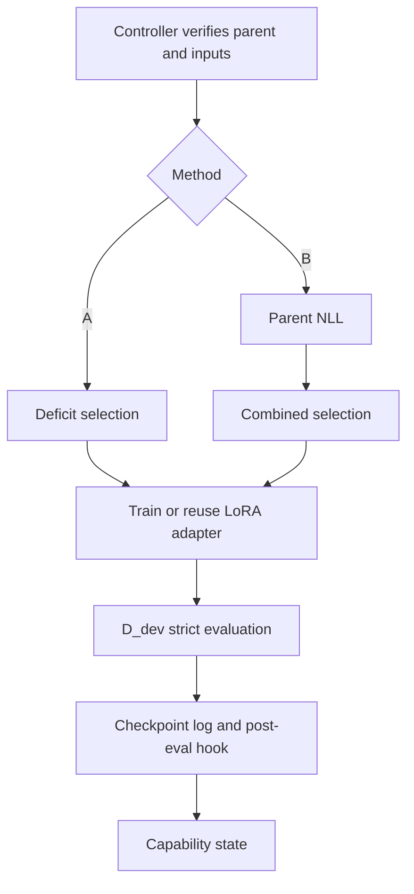

# Architecture

The handoff retains `runtime/P2/experiments/week2September/manual`. Both runtime and candidate source use the original import hierarchy. The main entrypoint is `scripts/run_p1_p2.py`, wrapping controller, path resolver, artifact manager and method/round policy. The frozen config, registry and unified config remain under manual/config. Referenced package-level support is under runtime/P2/integration_staging and the dependency lock is under runtime/P2.

B computes or validates the required parent NLL before combined selection. A selects from capability deficits without NLL. The subsequent order is LoRA (when needed), D_dev evaluation, checkpoint log, hook and capability state. An existing verified A S2 adapter removes the training stage. Operator wrappers call the same controller and add scope confirmation, checksum and result-transport checks.

A final-stage D_test wrapper and the G6/G7/G8 analysis scripts remain outside the unified per-round evaluation path. Charts and analysis do not shape prerequisite graph results. Keep the complete byte-equivalent private package, a separate writable work tree, and the independent publication candidate. Source-to-copy fingerprints are in manifests/source_to_handoff_mapping.csv.
